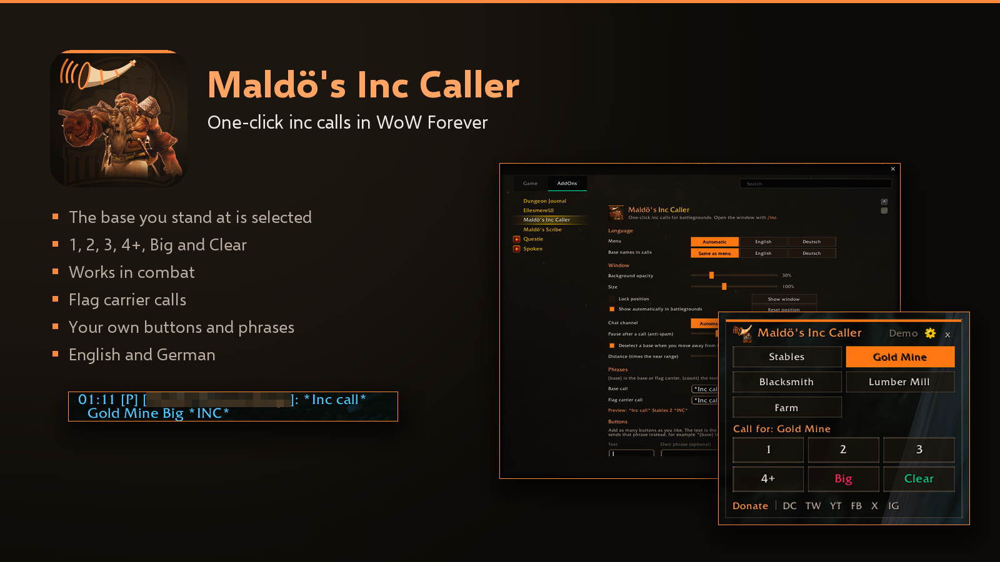
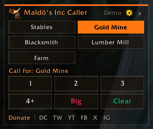
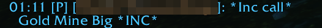
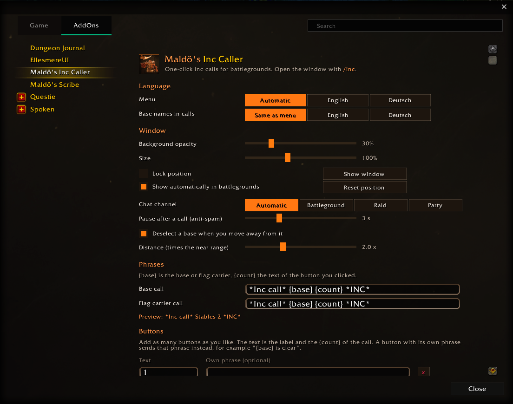

# Maldö's Inc Caller



One-click "inc" calls for battlegrounds in **WoW Forever**.

Typing "3 inc stables" while you are being attacked costs the seconds your team needs. Maldö's Inc Caller
shows the bases of the battleground you are in, selects the one you are standing at, and sends the call with
one click:

```
*Inc call* Stables 3 *INC*
```

## Features

- **Bases per battleground**: Warsong Gulch, Arathi Basin, Alterac Valley and Darkspear Islands. Any other
  battleground uses its map markers.
- **The base you are at is selected for you.** A click selects another one, for example a base you can see
  from where you stand. When you walk away from a base, it is deselected again, so a call never goes out for
  a place you have left.
- **Call buttons**: 1, 2, 3, 4+, Big and Clear. Add as many of your own as you like, each with its own phrase.
- **Flag carrier**: in flag battlegrounds, call inc on the flag carrier the same way.
- **Your own phrases**: `{base}` is the base, `{count}` the text of the button.
- **No spam**: a short pause after each call (3 seconds by default, adjustable).
- **Works in combat**: calling and picking a base work while you fight.
- A small window that you can move, half transparent by default. Opacity and size are adjustable.
- English and German, following the game client. Every other language uses English.

| The window | The call in chat |
| --- | --- |
|  |  |



Tested in Darkspear Islands, Warsong Gulch and Arathi Basin. Alterac Valley has not been played with the
addon yet; please report what does not work there.

## Install

Install it from CurseForge like any other addon (game version: WoW Forever), or by hand:

1. Close the game.
2. Unzip the release (`MaldoesIncCaller-<version>.zip`) into `World of Warcraft\_forever_\Interface\AddOns\`,
   so that the folder `MaldoesIncCaller` is in there.
3. Start the game and enable the addon.

The addon loads in WoW Forever only.

## How to use

The window opens by itself when you enter a battleground and closes when you leave. `/inc` shows or hides it
at any time.

**Bases.** The upper part lists the bases. The one you are standing at has an amber mark and is selected.
Click another base to call for that one instead.

**Calls.** The buttons below send the call for the selected base to your team: the number of attackers,
**Big** for a large group, **Clear** when the base is safe again. After a call the buttons pause for a moment.

**In combat.** The game does not let an addon change its buttons during combat. Calling and picking a base
by hand work; opening, closing or moving the window and the automatic selection happen as soon as combat
ends.

**Outside a group** the call is only printed in your own chat, so you can try your phrases safely.
`/inc test` shows a demo outside a battleground. It behaves like the real thing: in a group the call goes
to that group, alone it is only printed for you.

| Command | What it does |
| --- | --- |
| `/inc` | Show or hide the window |
| `/inc options` | Open the options |
| `/inc test` | Demo with the bases of Arathi Basin |
| `/inc test flag` | Demo with a flag battleground |
| `/inc test darkspear` | Demo with Darkspear Islands |
| `/inc reset` | Put the window back to its place |
| `/inc log` | Show the error report to copy |
| `/inc debug` | Turn debug messages in chat on or off |

`/inccaller` and `/mic` do the same as `/inc`.

## Options

`/inc options`: language of the menu and of the base names in calls, window opacity and size, lock the
position, show the window automatically, the chat channel (automatic, battleground, raid or party), the
pause after a call, deselecting a base when you move away and the distance for that, the phrases, and the
list of call buttons.

## Reporting a problem

If something goes wrong, the addon catches the error and tells you in chat. Type `/inc log`, press Ctrl+C in
the window that opens, and paste the report into a [GitHub issue](https://github.com/nfMalde/MaldoesIncCaller/issues). The report holds the addon and game
version, your settings, the errors and the last log lines. It contains no character names and none of your
phrases.

## Development

- `tools/check`: syntax check, text keys and a smoke test that loads the addon in a Lua VM with a stand-in
  for the game API. Needs Node: `cd tools/check`, `npm install`, `npm run check`. The same runs on every
  push.
- `deploy.ps1` copies the addon into the WoW Forever AddOns folder; `release.ps1` builds the zip by hand.
- Changes go through pull requests; `main` only takes merges with a green check.
- Releases are made from the Actions tab (workflow "Release"): it computes the version from the last tag,
  takes the notes from `CHANGELOG.md`, builds the package for review and, after approval, uploads it to
  CurseForge and creates the tag and the GitHub release. The package holds only the addon folder.

## License

GNU General Public License v3.0, see [LICENSE](LICENSE). The Maldö name and the Maldö avatar
(`Media/maldoe.tga`, also in the background of the logo) are Maldö's own branding and are not covered by that licence; please do not reuse them
for other projects.

## Support

The addon is free. If you like it, you can support Maldö:
[PayPal](https://www.paypal.com/donate/?hosted_button_id=SVZHLRTQ6H4VL) ·
[Discord](https://discord.gg/GbvU9sns5z) ·
[Twitch](https://www.twitch.tv/maldoe) ·
[YouTube](https://www.youtube.com/@dermaldoe)
